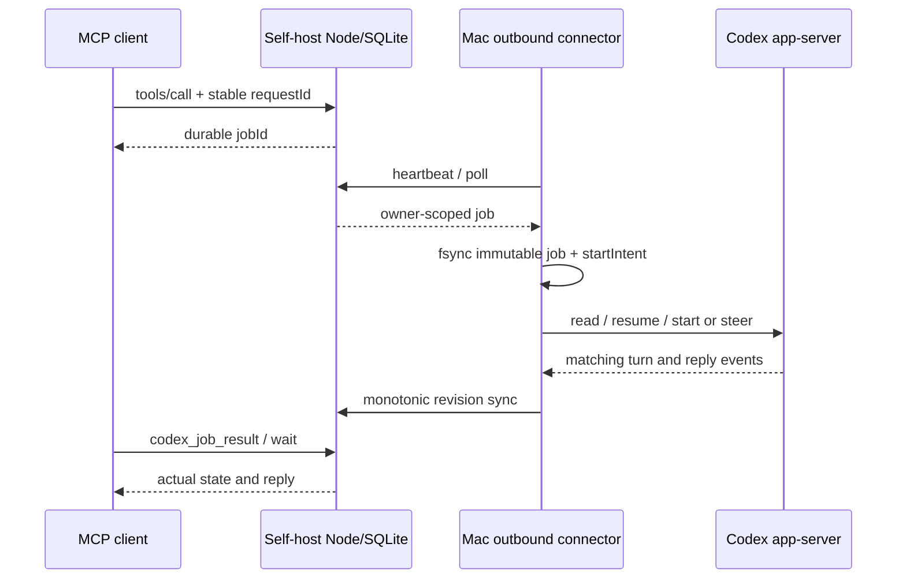

# 架构与协议

本说明来自固定源码及本次合成测试，不从聊天记录推断实现。

## 源码入口

| 责任 | 文件 |
|---|---|
| JSON-RPC initialize、工具与事件分发 | `service/app/mcp/route.ts` |
| owner、发现门禁、稳定请求、不可变载荷、任务查询 | `service/lib/bridge.ts` |
| poll/recover/sync/heartbeat、按 revision 更新 | `service/app/agent/route.ts` |
| 事件、订阅、重试、送达与 ACK | `service/lib/events.ts`, `subscriptions.ts`, `receipts.ts` |
| 有界等待与取消等待 | `service/lib/wait.ts`, `task-state.ts` |
| 出站主管、最新结果优先补传 | `service/connector/src/agent.py` |
| fsync 日志、account fingerprint、目标 turn 关联 | `service/connector/src/bridge.py` |
| app-server JSONL/RPC、超时与进程生命周期 | `transport.py`, `executable.py` |
| writer 冲突、同连接 steer、官方队列 fallback | `steering.py`, `official_queue.py` |
| TLS webhook 与健康探针 | `webhooks.py`, `reliability.py` |
| 独立 SQLite/D1 接口适配与可信身份注入 | `selfhost/core.mjs`, `service/lib/access.ts` |

## 请求与身份

`POST /mcp` 使用 MCP Bearer 凭据；`POST /agent` 使用独立设备头。适配层移除请求携带的所有 `oai-*` 身份头，再注入固定 `selfhost-owner`。设备凭据不能作为 MCP 凭据使用。HTTP 监听只在 loopback，外部 TLS 由部署者维护。

原托管版本曾由平台注入身份并查询商业权益。核心版已移除该模块及商业数据迁移，用独立 `access.ts` 校验唯一 operator 和设备。支付/统计代码仅在本机私有备份，不随核心包发布。静态认证下禁止 fetch 的测试仍能完成入队/轮询/同步/结果查询；OAuth 模式只向明确配置的公开 JWKS 端点取验证公钥。外部身份头不能越过验证。

`requestId` 在 owner 范围内稳定；同一 ID 改变 action 或载荷应被拒绝。`jobId`、原生 thread ID、turn ID、事件 ID、delivery ID 不是同一个标识。设备状态是合并后的单调 revision，迟到的旧状态不能覆盖新状态。

## 六层回执

| 证据 | 能证明什么 | 不能证明什么 |
|---|---|---|
| job 创建 | 服务已受理 | Mac 已收到或执行 |
| official queue accepted | 上游队列存下请求 | 目标会话收到、即刻 steer |
| targetReceived + 目标 turn/用户项 | 对应目标收到请求 | 执行结束 |
| completed + 对应消息 | 对应 turn 终态及已提取回复 | 外部通知送达 |
| webhook HTTP 成功 | 接收端收到回调 | Dot 已处理/向用户展示 |
| 应用 ACK | 客户端确认处理事件 | 业务结果正确或用户已阅读 |

原生未知结果不自动重发。`startIntent` 在写操作之前 fsync；恢复时读日志和目标证据。同连接、自有活动 turn 的 steer 与外部桌面 writer 的排队是不同能力。外部 writer 不能被强制释放。

## 已知协议边界

当前 MCP 实现包含产品自己的 events 扩展和 JSON-RPC 版本协商代码；本次没有证明其符合全部 MCP transport 版本。普通 JSON POST 合成测试通过，SSE、真实 OAuth 登录、客户端重新连接及 Dot 扩展兼容性还需单独验收。资源发现和访问令牌验证已有合成测试，详情见 [OAuth](oauth.md)。

原官方队列代码注明特定早期 CLI 版本不去重 queue/add、队列无 TTL。它依赖本地锁和 startIntent，五分钟期限后只尝试移除可验证的自有待发项；竞态下保留 delivery_unknown，不能保证绝不迟发。当前所有 CLI 版本的行为未知。

账号绑定覆盖本机可见存储，不证明每条旧会话的历史账号归属；cloud-only、未登记其他设备、临时会话、桌面工具继承和外部活动 turn 即时操控均不作承诺。通知个人固定路由已删除，健康状态可查；此轮未设置任何真实订阅。
