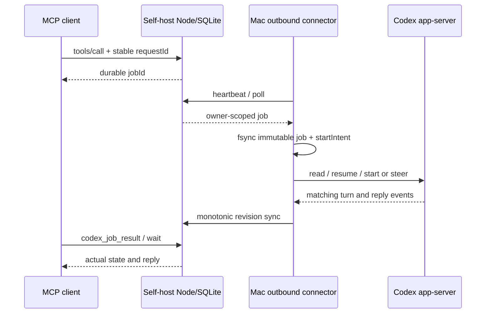

# Architecture and protocol

This description is based on the pinned source and synthetic tests, not implementation details inferred from conversations.

## Source entry points

| Responsibility | Files |
|---|---|
| JSON-RPC initialize, tool dispatch, and event dispatch | `service/app/mcp/route.ts` |
| Ownership, discovery gates, stable requests, immutable payloads, and job queries | `service/lib/bridge.ts` |
| poll/recover/sync/heartbeat and revision-based updates | `service/app/agent/route.ts` |
| Events, subscriptions, retries, delivery, and ACK | `service/lib/events.ts`, `subscriptions.ts`, `receipts.ts` |
| Bounded waits and wait cancellation | `service/lib/wait.ts`, `task-state.ts` |
| Outbound supervisor and catch-up that prioritizes recent results | `service/connector/src/agent.py` |
| fsync journal, account fingerprint, and target-turn correlation | `service/connector/src/bridge.py` |
| app-server JSONL/RPC, timeouts, and process lifecycle | `transport.py`, `executable.py` |
| Writer conflicts, steering on the same connection, and official queue fallback | `steering.py`, `official_queue.py` |
| TLS webhooks and health probes | `webhooks.py`, `reliability.py` |
| Independent SQLite/D1 adapter and trusted identity injection | `selfhost/core.mjs`, `service/lib/access.ts` |

## Requests and identity

`POST /mcp` uses an MCP Bearer credential; `POST /agent` uses a separate device header. The adapter strips all incoming `oai-*` identity headers before injecting the fixed `selfhost-owner`. A device credential cannot be used as an MCP credential. The HTTP listener binds only to loopback; the operator maintains external TLS.

The original hosted version relied on platform-injected identity and commercial entitlement checks. The core removes that module and the commercial database migrations, using an independent `access.ts` to validate a single operator and device. Payment/analytics code remains only in private local backups and is not distributed with the core. Static-authentication tests can enqueue, poll, synchronize, and retrieve results with fetch forbidden. OAuth mode fetches public verification keys only from the explicitly configured JWKS endpoint. External identity headers cannot bypass verification.

A `requestId` is stable within its owner scope. Reusing an ID with a different action or payload must be rejected. `jobId`, native thread ID, turn ID, event ID, and delivery ID are distinct identifiers. Device state is merged using monotonic revisions: a late older state cannot overwrite a newer one.

## Six receipt layers

| Evidence | What it establishes | What it does not establish |
|---|---|---|
| Job creation | The service accepted the request | The Mac received or executed it |
| Official queue accepted | The upstream queue stored the request | The target conversation received it, or immediate steering occurred |
| targetReceived + matching target turn/user item | The corresponding target received the request | Execution finished |
| completed + matching messages | The corresponding turn reached a terminal state and its reply was extracted | An external notification was delivered |
| Successful webhook HTTP response | The receiver received the callback | Dot processed it or displayed it to the user |
| Application ACK | The client acknowledged processing the event | The business result is correct or the user read it |

Unknown native execution outcomes are never automatically resent. `startIntent` is fsynced before a write; recovery reads the journal and target evidence. Steering an active turn owned by the same connection is different from queueing behind an external desktop writer. External writers must not be forcibly released.

## Known protocol boundaries

The MCP implementation includes product-specific events extensions and JSON-RPC version-negotiation code. This work does not establish compliance with every MCP transport version. Synthetic JSON POST tests pass; SSE, real OAuth login, client reconnection, and Dot extension compatibility need separate validation. Resource discovery and access-token verification have synthetic coverage; see [OAuth](oauth.md).

Comments in the original official-queue code note that certain early CLI versions do not deduplicate queue/add and that the queue has no TTL. Recovery relies on local locks and startIntent. After a five-minute deadline, it only attempts to remove pending items whose ownership can be verified. Races retain delivery_unknown, so late delivery cannot be ruled out. Behavior across all current CLI versions is unknown.

Account binding covers locally visible storage; it does not prove the historical account ownership of every old conversation. No support is promised for cloud-only conversations, unregistered other devices, temporary conversations, inherited desktop tools, or immediate control of externally owned active turns. Fixed personal notification routes were removed, and health status can be queried. No real subscriptions were configured during this preparation.
